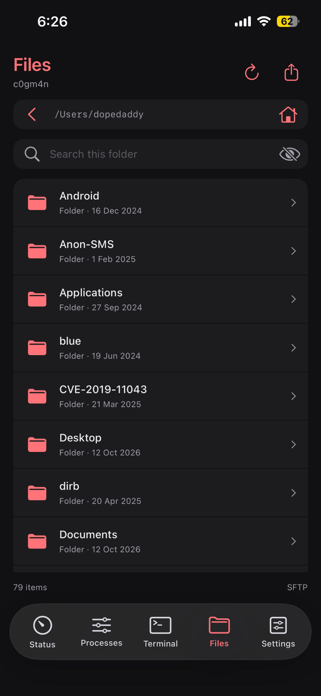
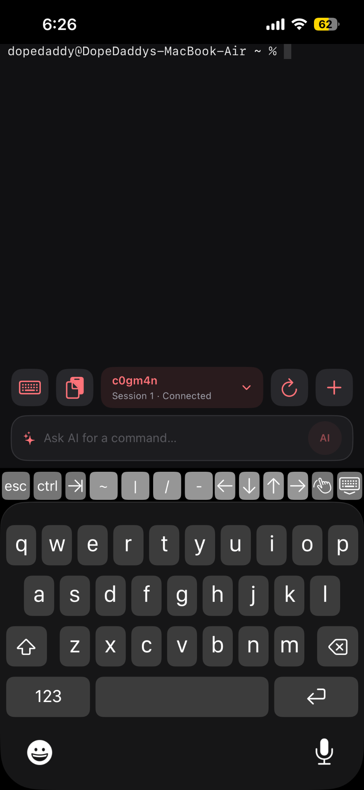
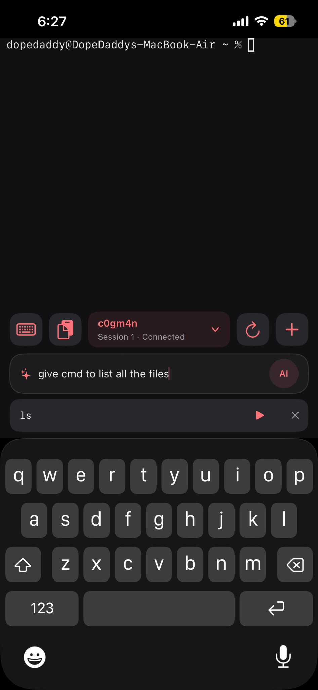

<div align="center">
  
  <h1>MARC</h1>
  <p><strong>Macintosh Access &amp; Remote Control</strong></p>
  <p>Your Mac, within reach. Monitor its activity, work in the terminal, transfer files, and adjust everyday controls from your iPhone.</p>
</div>

MARC connects to your Mac over SSH. It brings live system readings, an interactive terminal, SFTP file transfers, and remote controls into a compact interface with customizable sections and colour accents.

This project is under active development. The current app has been built and manually tested by its author; device and display compatibility may vary. No public App Store or downloadable binary release is included here yet.

## See MARC in action

Actual screenshots from the app. Device names, readings, available outputs and displays depend on the connected Mac.

<table>
  <tr>
    <th>Status</th>
    <th>Processes</th>
    <th>Control Center</th>
  </tr>
  <tr>
    <td></td>
    <td></td>
    <td></td>
  </tr>
</table>

<table>
  <tr>
    <th>Files</th>
    <th>Terminal</th>
    <th>AI command suggestions</th>
  </tr>
  <tr>
    <td></td>
    <td></td>
    <td></td>
  </tr>
</table>

<details>
  <summary><strong>Settings and appearance</strong></summary>
  <p>Manage saved servers, configure terminal AI, choose an appearance and accent colour, and set the system refresh interval.</p>
  
</details>

## What you can do

- **Monitor your Mac:** CPU and memory usage, network transfer rates, disk activity, battery state and available storage. Open System details for per-core readings, uptime, swap, network information and charts.
- **Customize Status:** show, hide and reorder sections. Power and Storage remain together. Choose which alerts appear and whether to show power status.
- **Investigate processes:** search running processes, sort by CPU, memory or name, and request termination with confirmation. Process identity is checked before sending a termination signal.
- **Use a real terminal:** interactive SSH sessions, session switching and shortcuts for common terminal keys.
- **Move files:** browse remote folders, upload from Files or Photos, preview downloaded files, and export through the iOS share sheet. Transfers show progress and support cancellation.
- **Control everyday settings:** Wi-Fi and supported Bluetooth switching, volume and mute, audio-output selection, and brightness for supported displays.
- **Get optional AI help:** suggest a command using Ollama on the connected Mac or a compatible HTTPS chat-completions API. Review the suggestion and explicitly choose to run it.

## Getting started

### Requirements

| Component | Requirement |
| --- | --- |
| iPhone | A version of iOS supported by the Xcode project; the current app target is iOS **26.6** |
| Development Mac | Xcode with an SDK compatible with the project; project-level defaults currently specify iOS 27.0 |
| Remote Mac | macOS with Remote Login enabled and `python3` available to the SSH user |
| Connection | A reachable SSH address, username and password; normally the same local network or a VPN |
| Optional Bluetooth switching | `blueutil` installed on the remote Mac |
| Optional AI | Ollama on the connected Mac, or a compatible HTTPS API and any required provider credentials |

The current project uses Swift language mode 5.0. Xcode resolves package dependencies through Swift Package Manager. The minimum deployment target is a project setting, not a claim that older iOS versions have been tested.

### Build the iPhone app

1. Download or clone this repository.
2. Open `MARC.xcodeproj` in Xcode.
3. Let Swift Package Manager resolve the versions in `Package.resolved`.
4. Select the **MARC** scheme and an appropriate simulator or connected iPhone.
5. For a physical device, choose your development team and a unique bundle identifier under **Signing & Capabilities**.
6. Build and run.

If a command-line build reports a missing `SwiftTermBuildInfoGenerator`, try building through Xcode with its normal package/build cache. This project encountered that dependency-tool issue when validating in a fresh isolated build directory.

### Connect to your Mac

1. On the remote Mac, enable **Remote Login** in **System Settings → General → Sharing** and allow the account you will use.
2. Verify SSH access from a terminal, for example:

   ```bash
   ssh yourusername@your-mac-address
   ```

3. Check that Python is available in that SSH session:

   ```bash
   python3 --version
   ```

4. In MARC, open **Settings → Add server**. Enter a display name, host, SSH port, username and password.
5. Pin a verified Ed25519 host key in the optional host-key field when available. Test the connection, then save and connect.
6. Open **Status**, **Processes**, **Terminal** or **Files**. Use the top-left button on Status to open **Control Center**.

MARC starts its monitoring commands through SSH. Standard live monitoring does not require a separately installed MARC web server. Longer archived-history periods require the separate history collector; the live five-minute history works without it.

## Alerts and refresh

| Check | Alert condition |
| --- | --- |
| Storage | At least 90% used; “almost full” at 95% |
| Battery | Below 20% while on battery; critical below 10% |
| CPU | At least 80% continuously for 30 seconds |
| Memory | At least 85% continuously for 60 seconds |
| Connection | Monitoring reports an error or readings become stale |

Memory alerts describe usage, not a confirmed macOS memory-pressure condition. CPU and memory checks require continuous samples; a brief spike does not trigger the sustained alert.

Customize these checks from **Customize → Choose alerts** or the settings icon beside **Needs attention**. When no enabled checks have an active alert, the section shows a brief status summary. These are in-app alerts, not background push notifications.

System refresh can be set to 1, 2 or 5 seconds. Power readings have a separate 5, 10, 30 or 60-second interval in Customize; changes apply after reconnecting. Control Center reads audio and display state approximately every five seconds while open, and wireless status approximately every 30 seconds. A manual refresh is also available.

## Connection, privacy and compatibility

- SSH passwords and AI API keys are stored in the iOS Keychain. Server profiles and display preferences are stored locally.
- Host-key verification is optional in the current implementation. An empty host-key field accepts the presented key; pin a verified key to protect against connecting to an impersonated host.
- Remote controls operate with the SSH account’s permissions. macOS can deny a request or restrict particular device settings.
- Turning off Wi-Fi may interrupt the SSH connection. MARC asks for confirmation before requesting it.
- Available audio outputs and displays are detected from the connected Mac. Displays that do not expose supported brightness control remain listed with brightness disabled. Brightness currently uses macOS’s private DisplayServices interface, so future macOS changes can affect compatibility.
- macOS may withhold the Wi-Fi network name from an SSH session even when Wi-Fi power status is available.
- Monitoring and terminal connections pause when the app enters the background. Keep MARC open for live monitoring and file transfers.
- AI is optional. Prompts go to the configured provider; choosing a remote API sends them to that endpoint. Suggested commands do not execute automatically.

## Built with

| Technology | Role |
| --- | --- |
| SwiftUI and UIKit | Interface, native controls and keyboard integration |
| Swift Charts | System-history charts |
| [Citadel](https://github.com/orlandos-nl/Citadel) | SSH and SFTP |
| [SwiftTerm](https://github.com/migueldeicaza/SwiftTerm) | Interactive terminal rendering |
| Python 3 on macOS | Monitoring and control commands executed over SSH |
| CoreAudio and DisplayServices | Audio-output and supported brightness control |

Exact direct and transitive dependency versions are recorded in `MARC.xcodeproj/project.xcworkspace/xcshareddata/swiftpm/Package.resolved`.

## Development and feedback

Bug reports, compatibility results and focused feature suggestions are welcome. Include the app build, iOS/macOS versions, the affected screen, and steps to reproduce. Remove passwords, API keys and other sensitive details from logs before sharing them.

The current functionality is intended to remain the free core. Future paid extensions or services may be developed separately; none are promised or required for the features shown here.

## License

The project’s open-source license has not yet been selected. A license and third-party notices will be added before the public open-source release. Dependencies retain their respective licenses.

## Author

Built by **Shivkumar Chougala**.

[GitHub](https://github.com/ShivkumarChougala) · [LinkedIn](https://thechougala.in/linkedin) · [Email](mailto:shivakumarchougala9@gmail.com)
