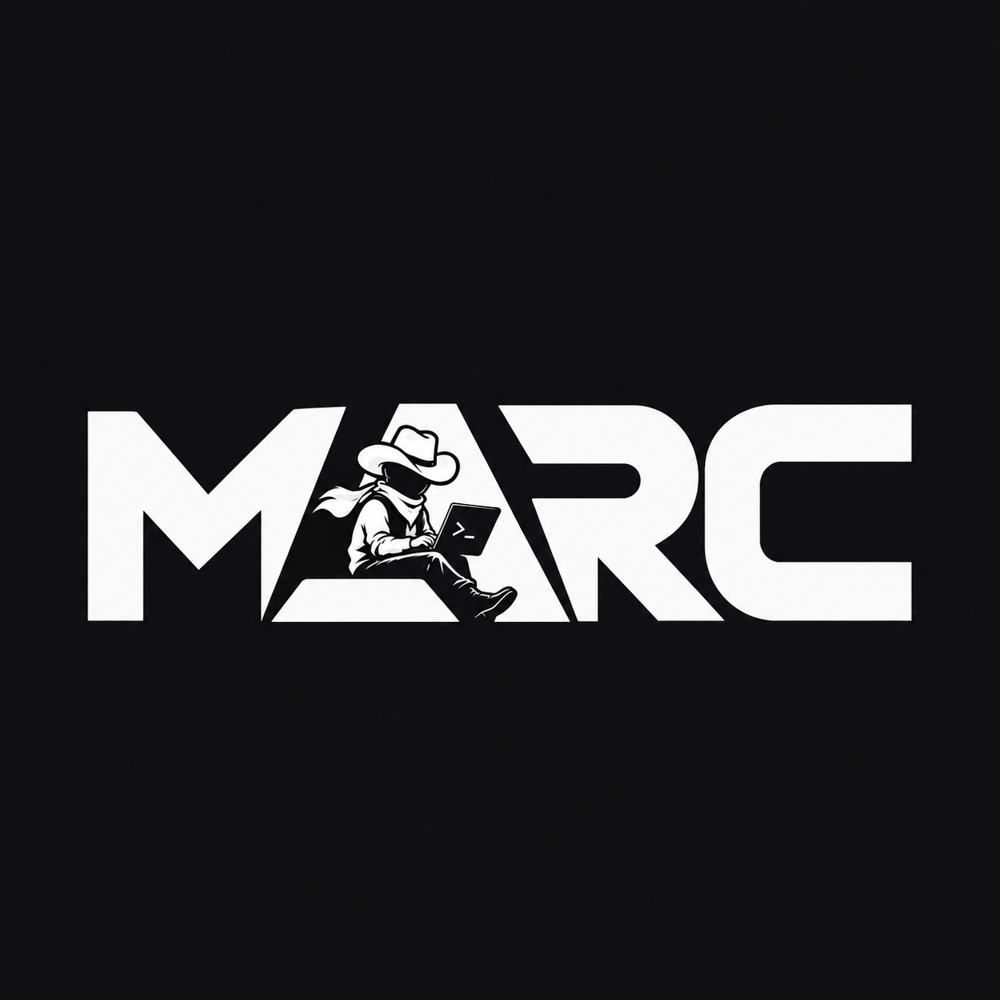
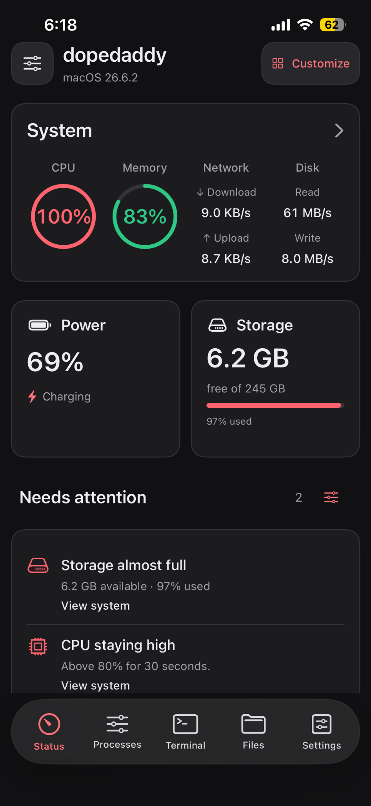
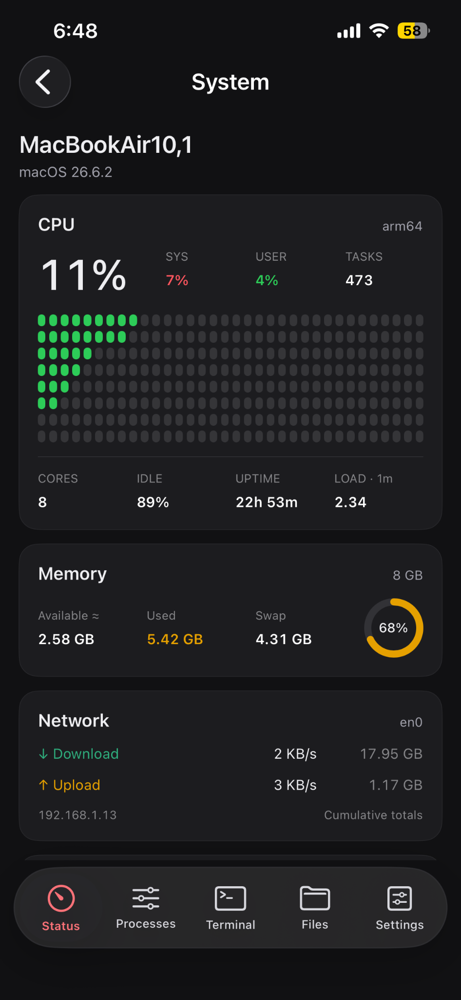
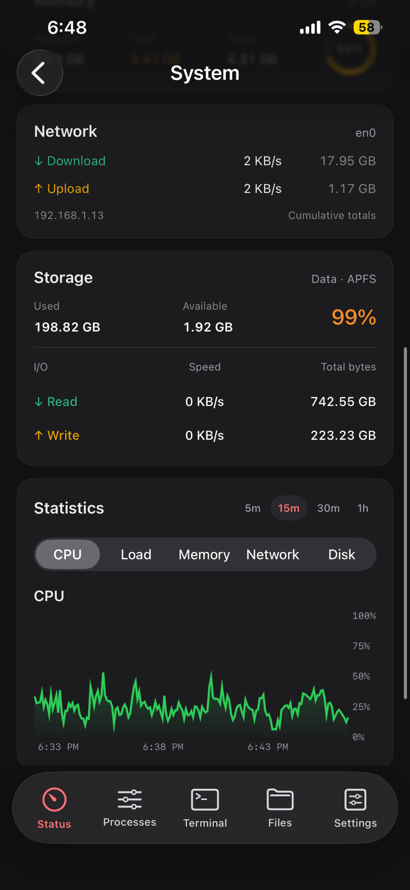
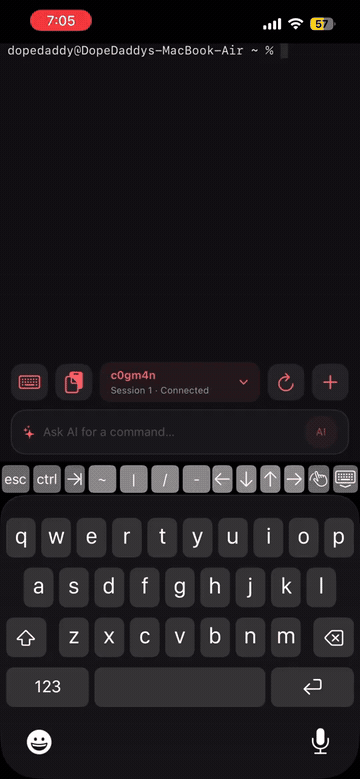
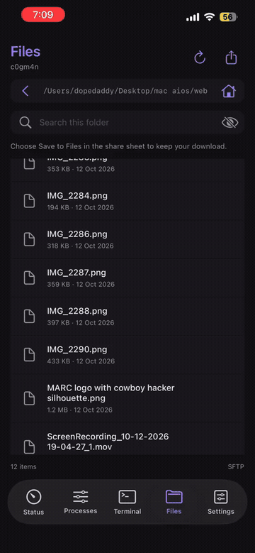
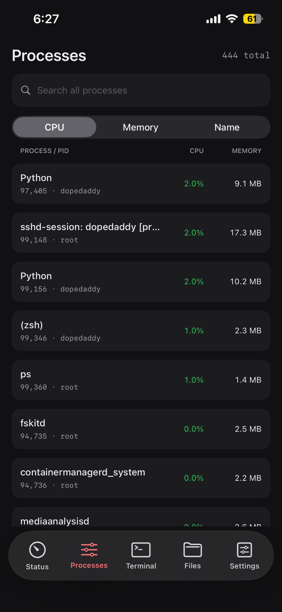
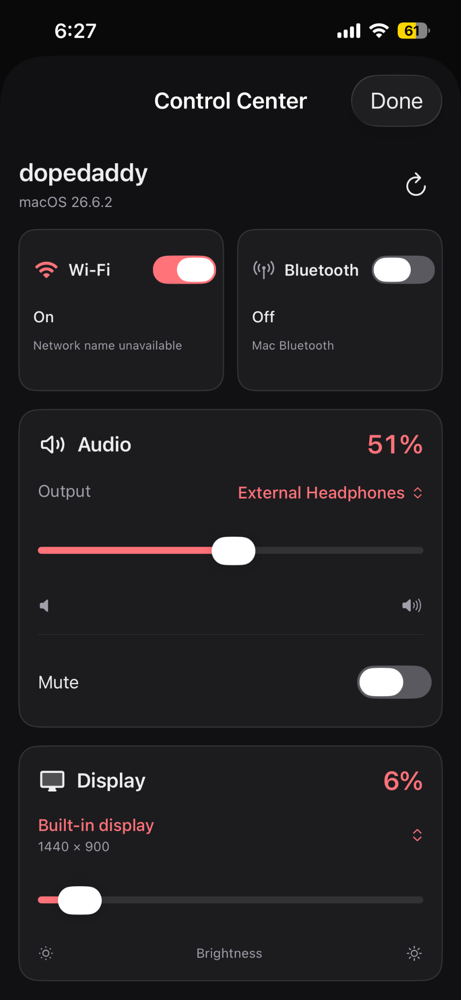
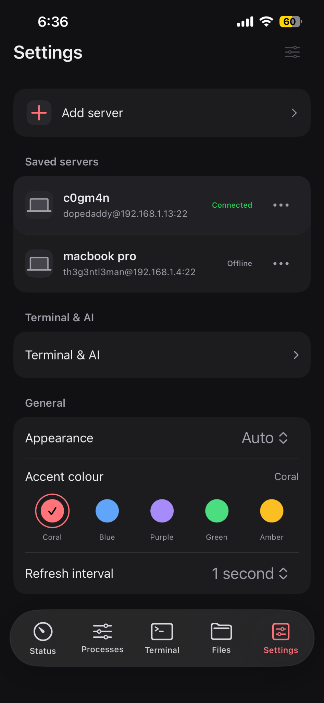

<div align="center">
  
  <h1>MARC</h1>
  <p><strong>Macintosh Access &amp; Remote Control</strong></p>
  <p>Monitor and manage your Mac from your iPhone.</p>
</div>

MARC connects to your Mac over SSH. Check system activity, manage processes, use the terminal, transfer files, and adjust audio and display settings from one app.

**Status:** Active development. Build from source using Xcode; a public binary release is not yet available.

## System monitoring

See live activity at a glance, then open System for CPU, memory, network, storage and history charts.

<table>
  <tr><th>Status</th><th>System details</th><th>Storage and statistics</th></tr>
  <tr>
    <td></td>
    <td></td>
    <td></td>
  </tr>
</table>

## Terminal AI and file transfers

<table>
  <tr><th>AI command suggestion</th><th>File upload</th></tr>
  <tr>
    <td></td>
    <td></td>
  </tr>
  <tr>
    <td><a href="docs/demos/terminal-ai.mp4">Watch the AI demo</a></td>
    <td><a href="docs/demos/file-upload.mp4">Watch the upload demo</a></td>
  </tr>
</table>

<details>
  <summary><strong>More screenshots</strong></summary>
  <table>
    <tr><th>Processes</th><th>Control Center</th><th>Settings</th></tr>
    <tr>
      <td></td>
      <td></td>
      <td></td>
    </tr>
  </table>
</details>

## Features

- **System monitoring:** live CPU, memory, network, disk, battery and storage readings, with detailed views and history charts.
- **Process management:** search and sort running processes, and terminate a selected process with confirmation.
- **SSH terminal:** interactive sessions, session switching and shortcuts for common terminal keys.
- **File transfers:** browse remote folders over SFTP, upload files or photos, and download, preview and share files.
- **Control Center:** volume, mute, audio-output selection, Wi-Fi, supported Bluetooth switching and display brightness.
- **Optional AI assistance:** request command suggestions using Ollama on your Mac or a compatible HTTPS API. Review each suggestion before choosing to run it.
- **Personalization:** light and dark appearance, accent colours, configurable refresh intervals, and adjustable Status sections and alerts.

## Build and run

You need Xcode, an iPhone or simulator supported by the project, and a Mac reachable over SSH. The current app target is iOS 26.6; project-level defaults specify iOS 27.0. Use an Xcode installation with a compatible SDK.

1. Download or clone the repository.
2. Open `MARC.xcodeproj` in Xcode.
3. Allow Swift Package Manager to resolve the dependencies.
4. Select the **MARC** scheme and your simulator or iPhone.
5. For a physical iPhone, choose your development team and a unique bundle identifier under **Signing & Capabilities**.
6. Build and run.

## Connect your Mac

1. On your Mac, enable **System Settings → General → Sharing → Remote Login** and allow the account you want to use.
2. Check that you can connect over SSH and that `python3` is available:

   ```bash
   ssh yourusername@your-mac-address
   python3 --version
   ```

3. In MARC, open **Settings → Add server** and enter the name, host, SSH port, username and password.
4. Add a verified Ed25519 host key in the optional host-key field, then test and save the connection.
5. Connect and open Status, Processes, Terminal or Files. Control Center is available from the top-left button on Status.

Use the same local network or a VPN that makes your Mac reachable. Standard monitoring runs through SSH and does not need a separate MARC web server.

## Optional setup

| Feature | Setup |
| --- | --- |
| Bluetooth switching | Install `blueutil` on the connected Mac. Status can be available without it. |
| Local AI assistance | Run Ollama on the connected Mac and choose an installed model in MARC. |
| Remote AI assistance | Configure a compatible HTTPS chat-completions endpoint, model and any required API key. |
| Longer history | Set up the separate history collector. The live five-minute chart works without it. |

## Privacy and compatibility

SSH passwords and AI API keys are stored in the iOS Keychain. Server profiles and appearance preferences are stored locally. AI assistance is optional; prompts are sent to the provider you configure, and suggested commands never run automatically.

Host-key verification is optional in the current version. Leaving the field empty accepts the key presented by the server. Pin a verified key to protect against connecting to an impersonated host.

Controls use the SSH account's permissions. Audio and brightness support depends on the Mac and its connected devices. Unsupported displays remain listed with brightness disabled. Brightness uses a private macOS interface, so compatibility may change with macOS updates.

Turning off Wi-Fi can disconnect your session and requires confirmation. macOS may also hide the Wi-Fi network name from SSH sessions.

Keep MARC open for live monitoring and transfers. Monitoring and terminal connections pause in the background. Alerts are shown inside the app; background push notifications are not currently provided.

## Built with

- SwiftUI, UIKit and Swift Charts
- [Citadel](https://github.com/orlandos-nl/Citadel) for SSH and SFTP
- [SwiftTerm](https://github.com/migueldeicaza/SwiftTerm) for terminal rendering
- Python 3 commands executed on the connected Mac
- CoreAudio and DisplayServices for audio and supported display controls

Dependency versions are recorded in `MARC.xcodeproj/project.xcworkspace/xcshareddata/swiftpm/Package.resolved`.

## Contributing

Bug reports and focused feature suggestions are welcome. Include your iOS and macOS versions, the affected screen, and steps to reproduce. Remove credentials and sensitive details from logs before sharing them.

For a larger change, open an issue first to discuss the approach. Keep pull requests focused and describe how you tested the change.

## Author

Built by **Shivkumar Chougala**.

[GitHub](https://github.com/ShivkumarChougala) · [LinkedIn](https://thechougala.in/linkedin) · [Email](mailto:shivakumarchougala9@gmail.com)
